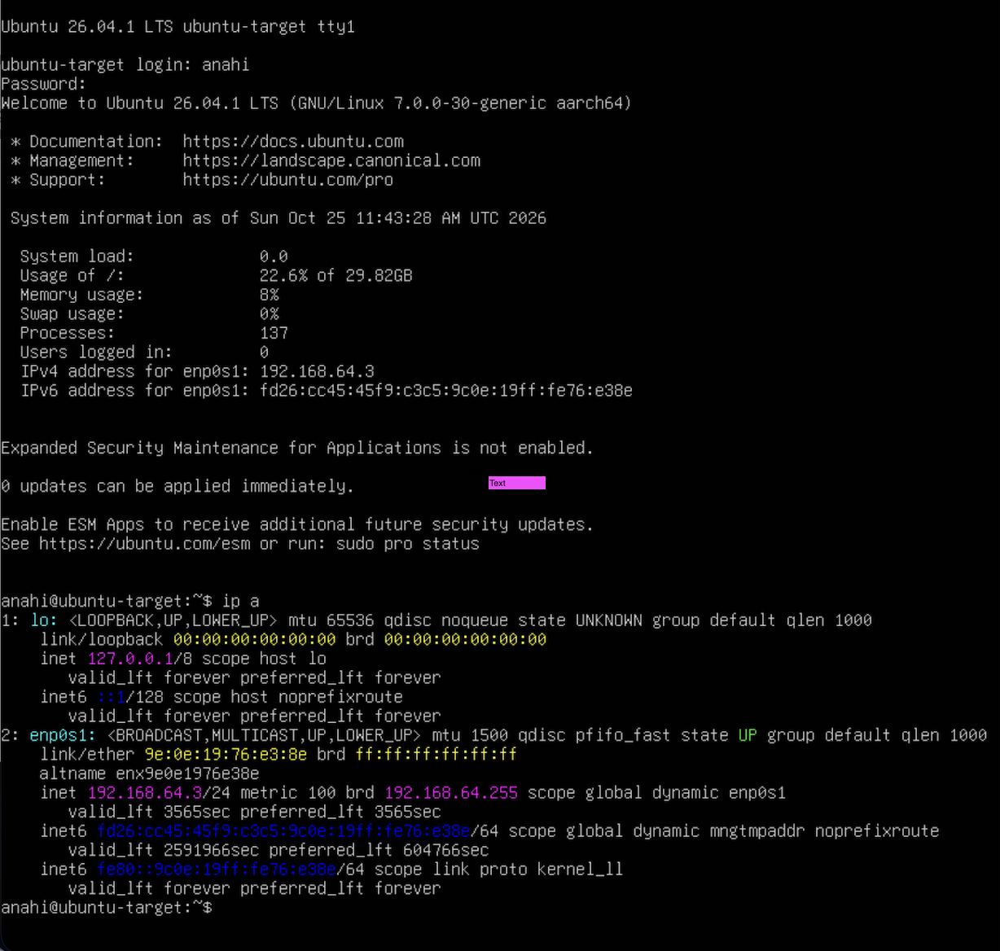
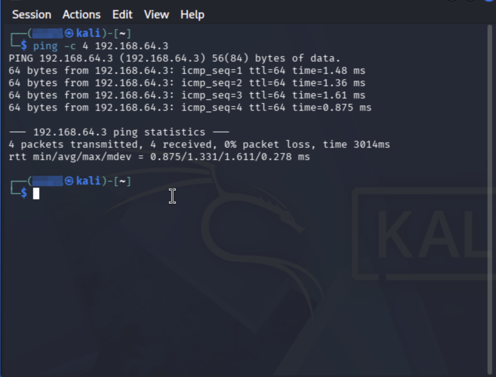
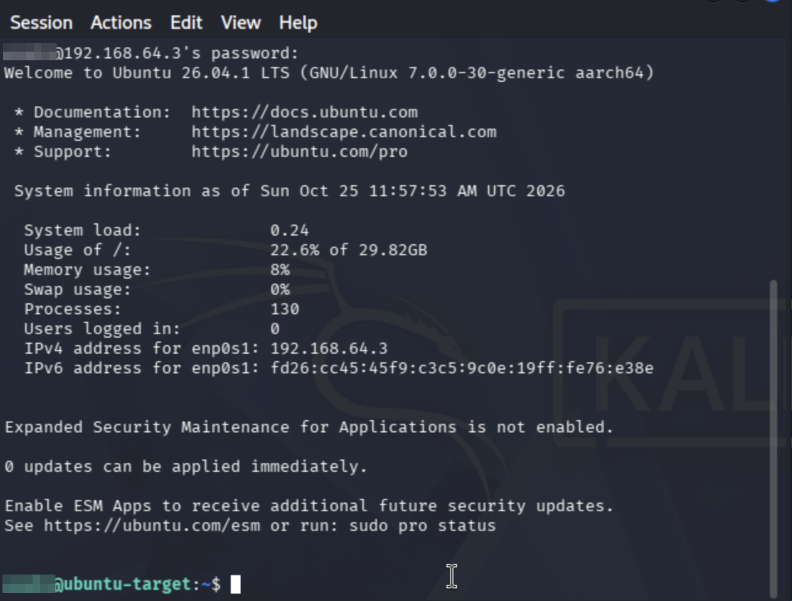
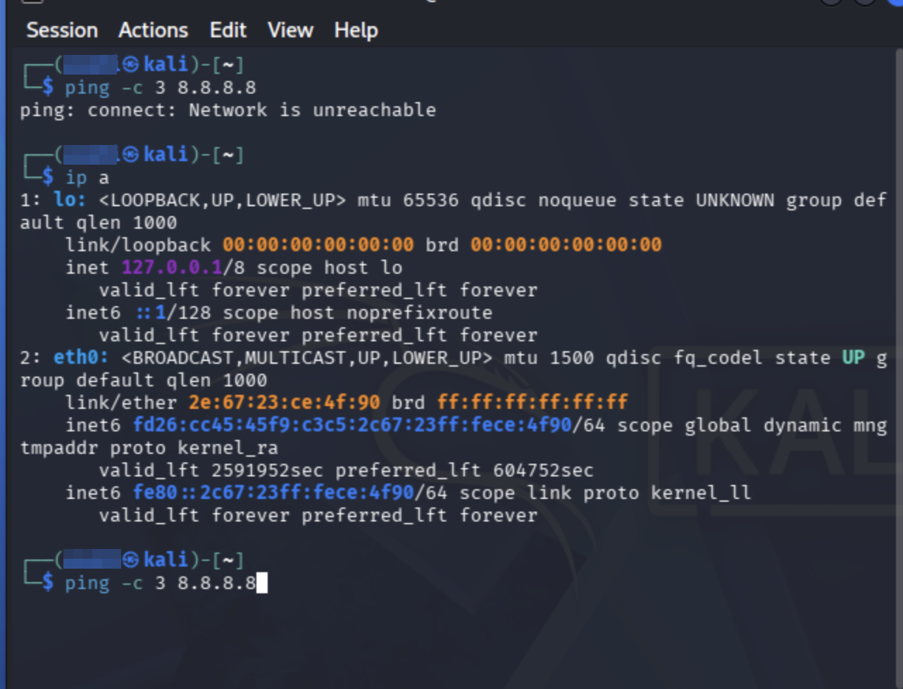
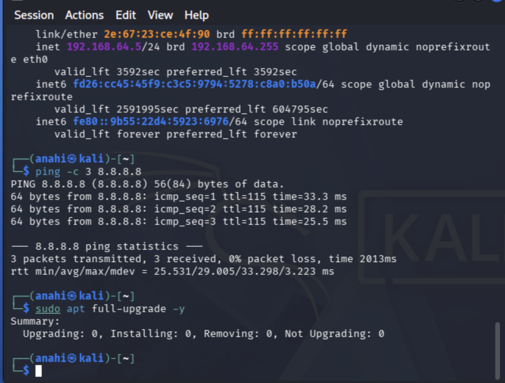

# Home Security Lab: Kali Linux and Ubuntu Server on Apple Silicon (UTM)

I built an isolated virtual lab on a MacBook with an Apple chip: an attacker machine (Kali Linux) and a target machine (Ubuntu Server) on a private network. I verified that the two machines can reach each other with `ping` and SSH, and I diagnosed and fixed a network failure along the way. This lab is the base for my later security projects (firewall configuration, vulnerability scanning, log monitoring).

**Date:** October 2026

**Tools:** UTM, Kali Linux 2026.2 (ARM64), Ubuntu Server 26.04.1 LTS (ARM64), OpenSSH, NetworkManager, `nmcli`, `ping`, `ip`

> Everything here ran on my own computer. The IP addresses are private lab addresses, and no passwords appear in the screenshots.

---

## Goal

Create a safe practice environment where I can run security tools against a machine I own, without touching my home network or any real system.

## Lab design

| Machine | Role | Operating system | IP address |
|---|---|---|---|
| Kali | Attacker / analyst workstation | Kali Linux 2026.2, ARM64 | 192.168.64.5 |
| Ubuntu-Target | Target server | Ubuntu Server 26.04.1 LTS, ARM64 | 192.168.64.3 |

Both VMs use UTM's **Shared Network** mode (192.168.64.0/24). They can talk to each other and reach the internet for updates, while other devices on my home Wi-Fi cannot reach them.

## What I did

1. Confirmed my Mac used an Apple chip, so I used **UTM** (free) instead of VirtualBox.
2. Downloaded the Kali **ARM64 installer** and the Ubuntu **Server ARM64** ISO from the official sites.
3. Created the Kali VM in UTM (4 GB memory, 64 GiB disk) and ran the graphical installer.
4. Shut it down after the install and removed the installer disc from the virtual drive, so the VM booted from its own disk.
5. Created the Ubuntu-Target VM and ran the text-based Ubuntu Server installer, with **OpenSSH server** enabled.
6. Confirmed both VMs were on the Shared Network.
7. Updated both systems with `sudo apt update` and `sudo apt full-upgrade -y`.
8. Found each machine's IP address with `ip a`.
9. Tested connectivity from Kali to Ubuntu with `ping`.
10. Tested a real connection with SSH from Kali into Ubuntu.
11. Shut both machines down and cloned them as `kali-clean-baseline` and `ubuntu-clean-baseline`, so I can restore a clean copy if I break something.

## Results

- `ping -c 4 192.168.64.3` from Kali returned **4 of 4 replies, 0% packet loss**.
- An SSH login from Kali into Ubuntu succeeded.
- Both machines can reach the internet for updates.
- Four VMs in UTM: two working machines and two clean backups.

**Kali running after login:**

**Ubuntu-Target's address (192.168.64.3):**

**Ping from Kali to Ubuntu:**

**SSH login from Kali into Ubuntu:**

**The four VMs in UTM, with clean backups:**

## Problems I ran into and how I fixed them

### 1. The pre-built Kali disk image would not boot

**Symptom:** I first downloaded Kali's pre-built QEMU disk image. UTM started the VM but stopped at a `UEFI Interactive Shell` prompt.

**Cause:** The VM had nothing bootable to start from. That image format did not work with my Apple-chip setup.

**Fix:** I deleted that VM and installed Kali from the official **ARM64 installer ISO** instead. This worked, and it is the better-documented method for Apple Silicon.

**Lesson:** When a VM drops to a UEFI shell, it cannot find a bootable disk, so check the image type before troubleshooting the VM settings.

### 2. The VM kept showing the installer menu after the install

**Symptom:** After installing Kali, the VM started the blue installer menu again.

**Cause:** The install disc was still attached to the VM as a virtual USB drive, and it was booting first.

**Fix:** In UTM, I opened the VM's settings, selected the drive holding the installer ISO, clicked **Clear**, and saved. Kali then booted straight to its login screen.

### 3. Kali had no internet: "Network is unreachable"

**Symptom:** `ping 8.8.8.8` failed with `Network is unreachable`, and `apt update` reported a repository error. `ip a` showed that `eth0` was up but had only IPv6 addresses and **no IPv4 address**.

**Investigation:** `nmcli device status` showed `eth0` as externally managed or unmanaged, and `/etc/network/interfaces` contained an old IPv6-only entry for `eth0`. NetworkManager was not requesting an IPv4 address for the interface.

**Fix:** I commented out the old IPv6-only `eth0` entry in `/etc/network/interfaces`, set NetworkManager to manage network interfaces (`managed=true`), and restarted NetworkManager. `eth0` then received `192.168.64.5` by DHCP from UTM's shared network, `ping 8.8.8.8` succeeded, and `apt update` worked.

**Lesson:** I worked from the symptom down: check the interface (`ip a`), then the network manager (`nmcli`), then the config files. I also learned to back up a config file before editing it.

## Skills demonstrated

- Setting up and managing virtual machines (UTM, QEMU, ARM64)
- Linux command line: `ip`, `ping`, `ssh`, `nmcli`, `systemctl`, `apt`, `sudo`
- Networking basics: IPv4 and IPv6, DHCP, private address ranges, isolated lab networks
- Network troubleshooting with a symptom-to-cause method
- Documenting a technical project

